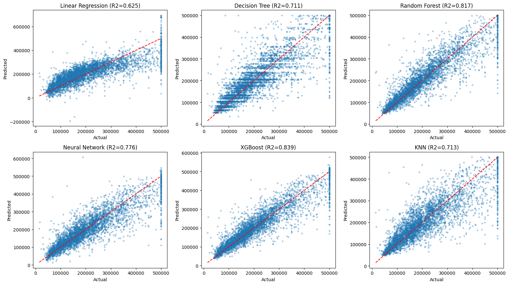

**Registration No: FA23-BAI-034**

---

# Assignment 04 / Lab 10 — Housing Price Prediction with Regression Models: Results

## 1. Dataset

California housing dataset (`housing.csv`): **20,640 rows × 10 columns**. The target is `median_house_value`.

| longitude | latitude | housing_median_age | total_rooms | total_bedrooms | population | households | median_income | median_house_value | ocean_proximity |
|---|---|---|---|---|---|---|---|---|---|
| -122.23 | 37.88 | 41.0 | 880.0 | 129.0 | 322.0 | 126.0 | 8.3252 | 452600.0 | NEAR BAY |
| -122.22 | 37.86 | 21.0 | 7099.0 | 1106.0 | 2401.0 | 1138.0 | 8.3014 | 358500.0 | NEAR BAY |
| -122.24 | 37.85 | 52.0 | 1467.0 | 190.0 | 496.0 | 177.0 | 7.2574 | 352100.0 | NEAR BAY |
| -122.25 | 37.85 | 52.0 | 1274.0 | 235.0 | 558.0 | 219.0 | 5.6431 | 341300.0 | NEAR BAY |
| -122.25 | 37.85 | 52.0 | 1627.0 | 280.0 | 565.0 | 259.0 | 3.8462 | 342200.0 | NEAR BAY |

## 2. Preprocessing and Setup

| Step | Detail |
|---|---|
| Missing values | `total_bedrooms` filled with its median |
| Categorical encoding | One-hot encoding of `ocean_proximity` (`drop_first=True`) |
| Train/test split | 80:20, `random_state=42` (same split for every model) |
| Scaling | `StandardScaler`, fit on the training set only |
| Metrics | MAE, MSE, RMSE, R² |

## 3. Models and Configurations

| # | Algorithm | Configuration |
|---|---|---|
| 1 | Linear Regression | Default |
| 2 | Decision Tree Regression | `max_depth=10`, `random_state=42` |
| 3 | Random Forest Regression | `n_estimators=100`, `random_state=42`, `n_jobs=-1` |
| 4 | Neural Network Regression (MLP) | Hidden layers (64, 32), `max_iter=500`, `early_stopping=True`, target scaled internally with `StandardScaler` |
| 5 | XGBoost Regression | `n_estimators=300`, `learning_rate=0.1`, `max_depth=6` |
| 6 | K-Nearest Neighbors Regression | `n_neighbors=5` |

## 4. Individual Model Results

| Model | MAE | MSE | RMSE | R² |
|---|---|---|---|---|
| Linear Regression | 50670.74 | 4908476721.16 | 70060.52 | 0.6254 |
| Decision Tree | 40766.51 | 3781900666.09 | 61497.16 | 0.7114 |
| Random Forest | 31631.02 | 2401861420.45 | 49008.79 | 0.8167 |
| Neural Network | 36395.75 | 2936378007.70 | 54188.36 | 0.7759 |
| XGBoost | 30582.49 | 2108672236.23 | 45920.28 | 0.8391 |
| KNN | 40854.40 | 3765913279.63 | 61367.04 | 0.7126 |

## 5. Comparative Performance Table (Sorted by R²)

| Rank | Model | MAE | MSE | RMSE | R² |
|---|---|---|---|---|---|
| 1 | XGBoost | 30582.4879 | 2.108672e+09 | 45920.2813 | 0.8391 |
| 2 | Random Forest | 31631.0187 | 2.401861e+09 | 49008.7892 | 0.8167 |
| 3 | Neural Network | 36395.7541 | 2.936378e+09 | 54188.3568 | 0.7759 |
| 4 | KNN | 40854.3978 | 3.765913e+09 | 61367.0374 | 0.7126 |
| 5 | Decision Tree | 40766.5105 | 3.781901e+09 | 61497.1598 | 0.7114 |
| 6 | Linear Regression | 50670.7382 | 4.908477e+09 | 70060.5218 | 0.6254 |

## 6. Actual vs Predicted Plots

## 7. Summary

- **Best model:** XGBoost (R² = 0.8391, RMSE = 45,920.28, MAE = 30,582.49), followed closely by Random Forest (R² = 0.8167).
- **Weakest model:** Linear Regression (R² = 0.6254, RMSE = 70,060.52).
- Ensemble tree methods (XGBoost, Random Forest) clearly outperformed the single tree, KNN and linear baselines.
- Decision Tree and KNN scored almost the same (R² 0.7114 vs 0.7126), with KNN marginally ahead on R² and RMSE, while the Decision Tree had a slightly lower MAE.
