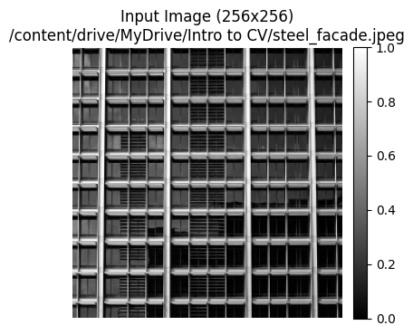
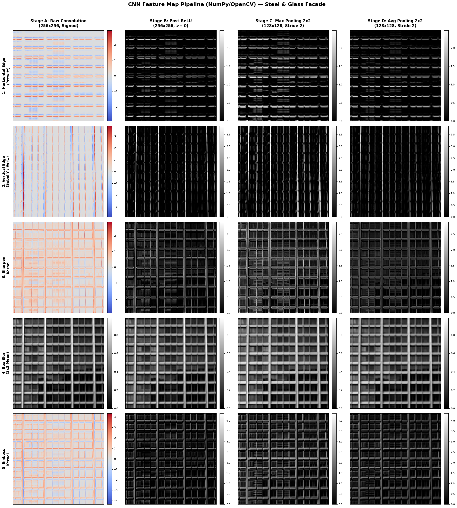

**Registration No: FA23-BAI-034**

---

# Lab 12 / Quiz 3 — CNN Feature Visualization, Parameter Audit & Critical Analysis: Results

## Table of Contents

1. [Overview](#1-overview)
2. [Setup: Image Loading](#2-setup-image-loading)
3. [Part I — NumPy/OpenCV Filter Pipeline (5 Kernels × 4 Stages)](#3-part-i--numpyopencv-filter-pipeline-5-kernels--4-stages)
4. [Part I — 5 × 4 Comparative Visualization Grid](#4-part-i--5--4-comparative-visualization-grid)
5. [Part II — PyTorch Architecture Comparison & Parameter Audit](#5-part-ii--pytorch-architecture-comparison--parameter-audit)
6. [Summary of Findings](#6-summary-of-findings)

> Click any **"Show raw output"** arrow below to expand the original printed notebook output.

---

## 1. Overview

| Item | Detail |
|---|---|
| Part I | Pure NumPy/OpenCV pipeline: 5 custom 3×3 kernels, each passed through 4 stages (Raw Convolution → ReLU → Max Pooling → Average Pooling) |
| Part II | PyTorch comparison of two lightweight CNNs (3×3 kernels + MaxPool vs 5×5 kernels + AvgPool) with a trainable-parameter audit |
| Input image | Steel-and-glass facade, grayscale, resized to 256 × 256 |

## 2. Setup: Image Loading

The image is loaded in grayscale, resized to 256 × 256 with `INTER_AREA`, and normalized to float32 in [0.0, 1.0]. If the file is missing, the notebook falls back to `skimage.data.camera()`.

| Property | Value |
|---|---|
| Source | `/content/drive/MyDrive/Intro to CV/steel_facade.jpeg` |
| Shape | (256, 256) |
| Value range | [0.00, 1.00] |



<details>
<summary><b>Show raw output</b></summary>

```text
Loaded: /content/drive/MyDrive/Intro to CV/steel_facade.jpeg | Shape: (256, 256) | Range: [0.00, 1.00]
```

</details>

## 3. Part I — NumPy/OpenCV Filter Pipeline (5 Kernels × 4 Stages)

### Pipeline stages

| Stage | Operation | Output size |
|---|---|---|
| A | Raw convolution (`cv2.filter2D`, `CV_32F`, zero padding) — keeps negative activations | 256 × 256 |
| B | ReLU: max(0, x) | 256 × 256 |
| C | 2 × 2 Max Pooling, stride 2 | 128 × 128 |
| D | 2 × 2 Average Pooling, stride 2 | 128 × 128 |

### Kernels used

| # | Kernel | Matrix (3 × 3) |
|---|---|---|
| 1 | Horizontal Edge (Prewitt) | `[[1, 1, 1], [0, 0, 0], [-1, -1, -1]]` |
| 2 | Vertical Edge (Sobel-Y / Vert.) | `[[1, 0, -1], [2, 0, -2], [1, 0, -1]]` |
| 3 | Sharpen | `[[0, -1, 0], [-1, 5, -1], [0, -1, 0]]` |
| 4 | Box Blur (3×3 Mean) | all ones ÷ 9 |
| 5 | Emboss | `[[-2, -1, 0], [-1, 1, 1], [0, 1, 2]]` |

### Per-stage statistics

| Filter | Stage A min | Stage A max | Stage A % < 0 | Stage B % == 0 | Stage C MaxPool mean | Stage C MaxPool max | Stage D AvgPool mean | Stage D AvgPool max |
|---|---|---|---|---|---|---|---|---|
| 1. Horizontal Edge (Prewitt) | -2.93 | 2.48 | 54.9% | 55.5% | 0.2774 | 2.48 | 0.1724 | 1.93 |
| 2. Vertical Edge (Sobel-Y) | -3.58 | 3.86 | 56.0% | 58.9% | 0.3782 | 3.86 | 0.2227 | 3.64 |
| 3. Sharpen | -1.57 | 2.89 | 27.7% | 27.8% | 0.6195 | 2.89 | 0.3812 | 1.79 |
| 4. Box Blur (3×3 Mean) | 0.00 | 0.99 | 0.0% | 0.0% | 0.3614 | 0.99 | 0.3169 | 0.96 |
| 5. Emboss | -2.77 | 4.35 | 29.5% | 29.5% | 0.7718 | 4.35 | 0.5083 | 2.94 |

<details>
<summary><b>Show raw output</b></summary>

```text
Filter                   | Stage A (min, max, %<0)    | Stage B (%==0) | Stage C MaxP (mean, max) | Stage D AvgP (mean, max)
----------------------------------------------------------------------------------------------------------------------
1. Horizontal Edge (Pre  | (-2.93,  2.48,  54.9%) |   55.5%        | 0.2774,  2.48            | 0.1724,  1.93
2. Vertical Edge (Sobel  | (-3.58,  3.86,  56.0%) |   58.9%        | 0.3782,  3.86            | 0.2227,  3.64
3. Sharpen Kernel        | (-1.57,  2.89,  27.7%) |   27.8%        | 0.6195,  2.89            | 0.3812,  1.79
4. Box Blur (3x3 Mean)   | ( 0.00,  0.99,   0.0%) |    0.0%        | 0.3614,  0.99            | 0.3169,  0.96
5. Emboss Kernel         | (-2.77,  4.35,  29.5%) |   29.5%        | 0.7718,  4.35            | 0.5083,  2.94
```

</details>

## 4. Part I — 5 × 4 Comparative Visualization Grid

Rows are the five kernels; columns are Stage A (signed, `coolwarm`), Stage B (post-ReLU), Stage C (max pooled) and Stage D (average pooled).



## 5. Part II — PyTorch Architecture Comparison & Parameter Audit

Both models take a 3-channel 32 × 32 input and share the same layout: Conv(3→5) → ReLU → Pool → Conv(5→10) → ReLU → Pool → Global Avg Pool → Flatten → Linear(10→10).

| | Model A (Standard) | Model B (Large Kernel) |
|---|---|---|
| Kernel size | 3 × 3 | 5 × 5 |
| Pooling | MaxPool 2×2, stride 2 | AvgPool 2×2, stride 2 |

### Model A — 3×3 Kernels + MaxPool 2×2 (stride 2)

| Layer | Output Shape | Trainable Params |
|---|---|---|
| conv1 | [1, 5, 30, 30] | 140 |
| relu1 | [1, 5, 30, 30] | 0 |
| pool1 | [1, 5, 15, 15] | 0 |
| conv2 | [1, 10, 13, 13] | 460 |
| relu2 | [1, 10, 13, 13] | 0 |
| pool2 | [1, 10, 6, 6] | 0 |
| gap | [1, 10, 1, 1] | 0 |
| flatten | [1, 10] | 0 |
| fc | [1, 10] | 110 |
| **Total Trainable Parameters** | | **710** |

### Model B — 5×5 Kernels + AvgPool 2×2 (stride 2)

| Layer | Output Shape | Trainable Params |
|---|---|---|
| conv1 | [1, 5, 28, 28] | 380 |
| relu1 | [1, 5, 28, 28] | 0 |
| pool1 | [1, 5, 14, 14] | 0 |
| conv2 | [1, 10, 10, 10] | 1,260 |
| relu2 | [1, 10, 10, 10] | 0 |
| pool2 | [1, 10, 5, 5] | 0 |
| gap | [1, 10, 1, 1] | 0 |
| flatten | [1, 10] | 0 |
| fc | [1, 10] | 110 |
| **Total Trainable Parameters** | | **1,750** |

### Parameter Audit Verification

| Model | Total Trainable Parameters |
|---|---|
| Model A (3×3, MaxPool) | 710 |
| Model B (5×5, AvgPool) | 1,750 |
| **Increase (B vs A)** | **+146.48%** |

Parameter counts per layer (weights + bias):

| Layer | Model A (3×3) | Model B (5×5) |
|---|---|---|
| conv1 | 3·5·3·3 + 5 = 140 | 3·5·5·5 + 5 = 380 |
| conv2 | 5·10·3·3 + 10 = 460 | 5·10·5·5 + 10 = 1,260 |
| fc | 10·10 + 10 = 110 | 10·10 + 10 = 110 |

<details>
<summary><b>Show raw output</b></summary>

```text
========================================================================
Model A (Standard): 3x3 Kernels + MaxPool 2x2 (stride 2)
========================================================================
Layer (Name)             | Output Shape           | Trainable Params
------------------------------------------------------------------------
conv1                    | [1, 5, 30, 30]         |              140
relu1                    | [1, 5, 30, 30]         |                0
pool1                    | [1, 5, 15, 15]         |                0
conv2                    | [1, 10, 13, 13]        |              460
relu2                    | [1, 10, 13, 13]        |                0
pool2                    | [1, 10, 6, 6]          |                0
gap                      | [1, 10, 1, 1]          |                0
flatten                  | [1, 10]                |                0
fc                       | [1, 10]                |              110
------------------------------------------------------------------------
Total Trainable Parameters                        |              710

========================================================================
Model B (Large Kernel): 5x5 Kernels + AvgPool 2x2 (stride 2)
========================================================================
Layer (Name)             | Output Shape           | Trainable Params
------------------------------------------------------------------------
conv1                    | [1, 5, 28, 28]         |              380
relu1                    | [1, 5, 28, 28]         |                0
pool1                    | [1, 5, 14, 14]         |                0
conv2                    | [1, 10, 10, 10]        |            1,260
relu2                    | [1, 10, 10, 10]        |                0
pool2                    | [1, 10, 5, 5]          |                0
gap                      | [1, 10, 1, 1]          |                0
flatten                  | [1, 10]                |                0
fc                       | [1, 10]                |              110
------------------------------------------------------------------------
Total Trainable Parameters                        |            1,750

Audit Verification -> Model A: 710 | Model B: 1750 | Increase: +146.48%
```

</details>

## 6. Summary of Findings

- **Edge kernels (Prewitt, Sobel-Y)** produce signed responses, with about 55–56% of Stage A values negative; ReLU then zeroes 55.5% and 58.9% of pixels, leaving sparse maps that highlight only the edges of the facade grid.
- **Sharpen and Emboss** keep more activations alive after ReLU (about 28–30% zeroed) and have the highest pooled means (Max Pool mean 0.6195 and 0.7718).
- **Box Blur** has no negative values (0.0%), so ReLU changes nothing, and its output range stays within [0.00, 0.99].
- **Max Pooling vs Average Pooling:** for every kernel, Max Pooling keeps the peak activation (e.g. 3.86 for the Sobel-Y kernel), while Average Pooling lowers both the mean and the maximum (e.g. 3.64 for Sobel-Y, 1.79 for Sharpen), smoothing the map.
- **Parameter audit:** moving from 3×3 to 5×5 kernels raises trainable parameters from 710 to 1,750 (+146.48%). Only the convolution layers change; the fully connected layer stays at 110 parameters in both models.
