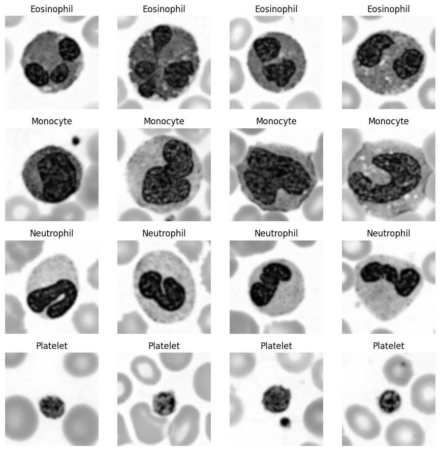
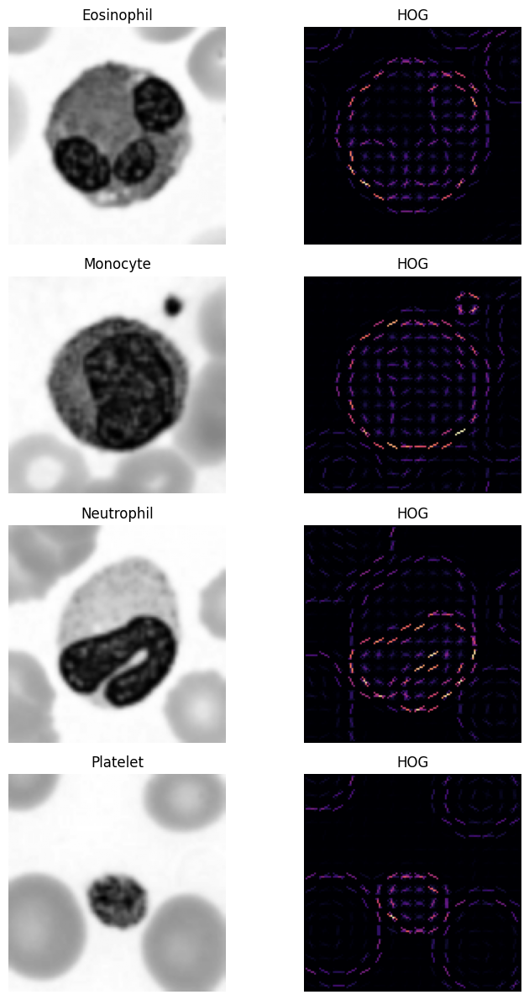
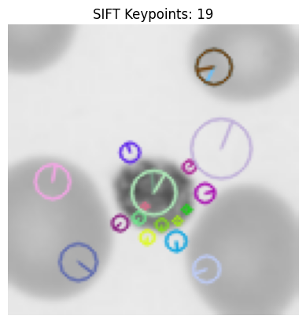
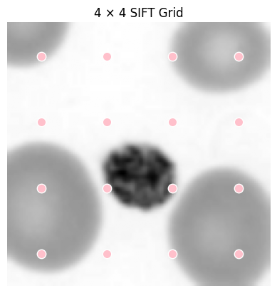
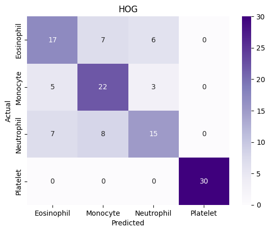
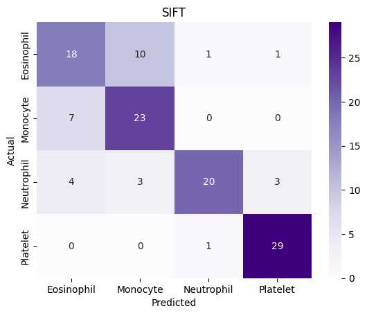
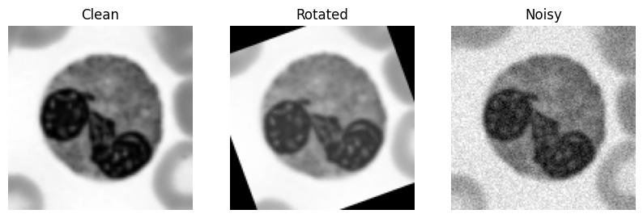
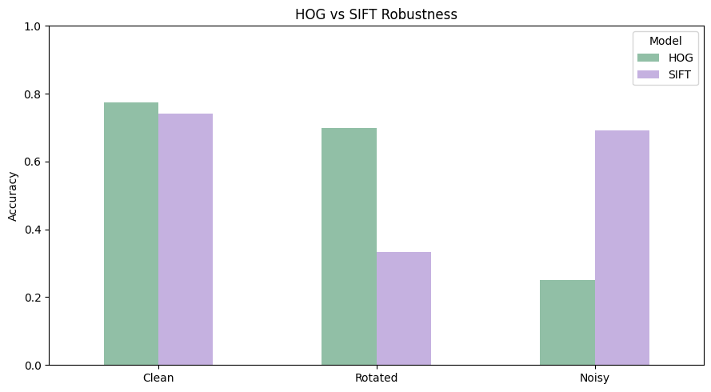

# My Results: Blood Cell Classification (HOG vs SIFT + Linear SVM)

**Classes:** Eosinophil, Monocyte, Neutrophil, Platelet
**Data:** 400 train (100 per class), 120 validation (30 per class), 120 test (30 per class)
**Seed:** 34 | **Random-guess baseline:** 25%

## Sample images

## Features
| | HOG | SIFT |
|---|---|---|
| Feature length | 8100 | 2048 |
| Best C | 0.1 | 1 |

SIFT keypoints per training image: average 72.3, min 9, max 178, zero-keypoint images 0.

### HOG visualisation

### SIFT keypoints and grid

## C tuning (validation accuracy)
| | C=0.1 | C=1 | C=10 |
|---|---|---|---|
| HOG | 0.70 | 0.70 | 0.70 |
| SIFT | 0.7333 | 0.75 | 0.7417 |

## Validation results
| | HOG | SIFT |
|---|---|---|
| Accuracy | 0.70 (84/120) | 0.75 (90/120) |
| Macro F1 | 0.6971 | 0.7493 |

## Confusion matrix: HOG (rows = actual, columns = predicted)
| | Eosinophil | Monocyte | Neutrophil | Platelet |
|---|---|---|---|---|
| Eosinophil | 17 | 7 | 6 | 0 |
| Monocyte | 5 | 22 | 3 | 0 |
| Neutrophil | 7 | 8 | 15 | 0 |
| Platelet | 0 | 0 | 0 | 30 |

## Confusion matrix: SIFT (rows = actual, columns = predicted)
| | Eosinophil | Monocyte | Neutrophil | Platelet |
|---|---|---|---|---|
| Eosinophil | 18 | 10 | 1 | 1 |
| Monocyte | 7 | 23 | 0 | 0 |
| Neutrophil | 4 | 3 | 20 | 3 |
| Platelet | 0 | 0 | 1 | 29 |

## Per-class precision / recall
| Class | HOG P | HOG R | SIFT P | SIFT R |
|---|---|---|---|---|
| Eosinophil | 0.59 | 0.57 | 0.62 | 0.60 |
| Monocyte | 0.59 | 0.73 | 0.64 | 0.77 |
| Neutrophil | 0.63 | 0.50 | 0.91 | 0.67 |
| Platelet | 1.00 | 1.00 | 0.88 | 0.97 |

## Robustness (test accuracy)
| Model | Clean | Rotated (20°) | Noisy (σ=0.05) |
|---|---|---|---|
| HOG | 0.775 | 0.700 | 0.250 |
| SIFT | 0.742 | 0.333 | 0.692 |

## Most confused classes
**Eosinophil vs Monocyte: 29 errors** (HOG 12 + SIFT 17)

## Explanation
- **Accuracy** = correct predictions / total. **Macro F1** = average of per-class F1 (balance of precision and recall).
- **Positive/negative:** for each class, that class is "positive". TP = correctly found, FN = missed, FP = false alarm, TN = correctly rejected. Example, Eosinophil with HOG: TP 17, FN 13, FP 12, TN 78.
- **Platelets** are easy (almost 100%); the three white blood cells are confused with each other, mainly Eosinophil vs Monocyte.
- **HOG** collapses with noise (25% = random chance) because noise creates false edges; it handles rotation fairly well.
- **SIFT** handles noise well but fails on rotation (33%) because descriptors were taken on a fixed grid with no orientation.
- On clean data both reach about 70-77%, far above the 25% baseline.
